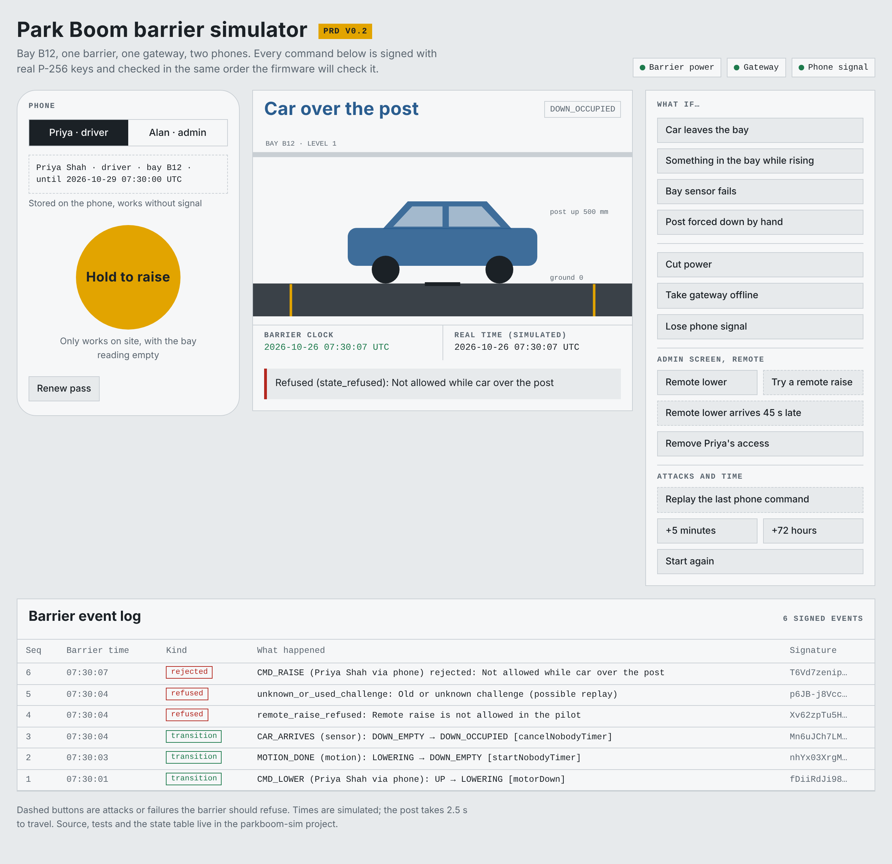

# Park Boom barrier simulator

[](https://github.com/alandavid7/parkboom-barrier-simulator/actions/workflows/ci.yml)

Park Boom is a phone-operated parking barrier. This repo is its safety rules and security protocol, written as runnable TypeScript and tested before any hardware exists: 49 tests, including property-based checks that the post can never rise over a car.



To try it, download [`dist/park-boom-simulator.html`](dist/park-boom-simulator.html) and open it in any browser. It's one file and works offline.

## What it is

A software stand-in for one Park Boom barrier, its gateway, the cloud and two phones. It runs the rules and the security protocol from PRD v0.2 with real P-256 signatures, so both can be tested before any hardware exists.

It isn't firmware and it doesn't talk to a real barrier. It's the reference the firmware, the iOS app and the backend will be checked against.

## Run it

Needs Node 22.

```
npm install
npm run typecheck   # strict TypeScript, no output means clean
npm test            # 49 tests, about 2 seconds
npm run build       # writes dist/park-boom-simulator.html (one file, opens offline)
npm run all         # all three
```

Open `dist/park-boom-simulator.html` in a browser to drive it by hand.

## What each folder becomes in the real build

| Folder | What it is here | What it becomes |
|---|---|---|
| `spec/barrier-states.json` | Every state, event, guard and action of the barrier, as data | Kept as is. Firmware generates its transition table from this file; the app reads the state labels from it. Change the rules here and nowhere else. |
| `src/barrier/stateMachine.ts` | Runs the table and checks it's complete | Reference engine. The C firmware is tested against the same inputs and must give the same outputs. |
| `src/barrier/barrier.ts` | The barrier's security checks, in the order they run, plus the motor and timers | Spec for the firmware's command handler. The check order is the part to copy exactly. |
| `src/protocol/` | Message formats (versioned, `v: 1`), canonical JSON, signing | Shared package for the iOS app (ported to Swift) and the backend (used directly). `Signer` is an interface: swap `MemorySigner` for AWS KMS in the cloud and the Secure Enclave on the phone. |
| `src/cloud/cloud.ts` | Issues passes, signed time, revocation lists, remote commands; stores events | The core of the backend's credential service. Storage moves to Postgres. |
| `src/phone/phone.ts` | Holds a pass, answers a barrier challenge | Logic for the iOS Bluetooth module. |
| `src/sim/world.ts` | The pretend car park that wires it all together | Simulator only. Not shipped. |
| `test/` | State-table properties, protocol attacks, PRD failure scenarios | Runs in CI on every change. The scenario names match the PRD failure table (F-03, F-06 and on). |
| `web/` | The demo page | Simulator only. Useful for demos and for testers. |

## What the tests prove

- **The rules.** Seven properties checked against 3,000 random event sequences each. The post never starts rising unless the bay reads empty and the sensor is healthy. A raise only starts from a phone on site. Anything detected while rising sends it back down. A refused input never changes state. Nothing drives the motor in Fault, Jammed or Maintenance. Only an accepted on-site clear brings a failed sensor back.
- **The protocol.** Replayed commands, expired challenges, expired passes, passes for another bay or another organisation, stolen passes on a different phone, tampered commands, revoked phones, the wrong role, replayed or backdated signed time, remote raise, late or duplicated remote commands and forged gateway commands are all refused. A random mix of these attacks never moves the post.
- **The failure table.** Power cut mid-lower, obstruction while rising, car over the post, faulty sensor, removed driver, late remote lower, forced-down post, nobody parks, no signal, gateway offline.

## Known gaps

- Bluetooth itself isn't simulated: messages pass as objects. Packet size, pairing and range are hardware-week problems.
- Signatures are raw `r||s`. KMS and the Secure Enclave return DER; convert at the `Signer` boundary.
- One barrier, one gateway. Multi-bay and multi-site behaviour isn't modelled.
- Timings (2.5 s travel, 5 min reminder, 30 s challenge, 72 h pass) are PRD values, not measured ones.
